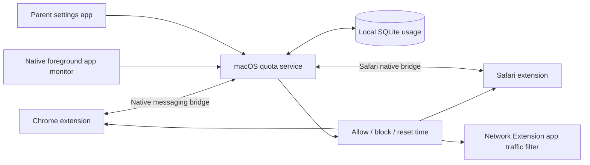

# kids-quota

Shared weekly website and application time allowances for macOS, with Chrome and
Safari support.

**Status:** project specification and architecture. No application or blocking
extension has been implemented or installed yet.

## Product requirements

- Support Chess.com and ChatGPT, each with its website and selected macOS app.
- Default to six hours per week for each service, with independent balances.
- Configure a weekly allowance in hours for a group of domains and selected Mac apps.
- Share each allowance across Chrome, Safari, and associated standalone apps for
  the same macOS user. For example, Chess.com gets six hours total per week.
- When a quota is exhausted, browser extensions block the website and replace open
  matching tabs. A Network Extension content filter cuts network access for the
  selected app, including handling its existing connections.
- Apps can still launch and display cached or offline features. Preventing launches
  or closing apps is outside the agreed initial scope.
- Reset automatically on a configurable weekday, defaulting to Monday at 00:00.
- Keep settings and usage on the Mac; no cloud account is needed for the initial version.
- Keep the interface simple: two service rows, clear remaining time and coverage,
  straightforward allowance editing, and one shared weekly reset setting.

## Recommended approach

Use a Swift macOS app and quota service with Chrome and Safari browser extensions.
The extensions know the actual page hostname, even when the connection is HTTPS.
The native app monitor identifies the frontmost selected application. The service
owns the shared balances, calendar boundaries, and persistent state, and counts
each foreground interval once. Browser extensions and the native Network Extension
content filter apply the same quota decision to websites and apps respectively.

The network filter identifies the selected app, including verified associated
network helpers, instead of guessing its service from server IP addresses. DNS
filtering remains an optional later addition. Neither DNS nor network activity
provides the foreground usage measurement.

## Proposed defaults

| Setting | Default |
| --- | --- |
| Reset | Monday, 00:00 |
| Timezone | Selected during setup; stays fixed until changed |
| Metering | Matching browser tab or selected standalone app in the foreground, while awake and unlocked |
| Passive viewing | Counts, including foreground video without mouse or keyboard activity |
| Background tabs and audio | Do not count in the first version |
| Domain matching | Exact hostname plus subdomains, configurable per entry |
| App matching | Explicit parent selection and verified application identity |
| Website enforcement | Chrome and Safari extensions |
| App enforcement | Network access blocked at exhaustion; offline features can remain available |
| Unused time | Does not carry over |
| Scope | One Mac; separate balances per macOS user |

See [the architecture](docs/architecture.md) for enforcement limits, timing rules,
and an implementation sequence. [The example policy](config/example-policy.json)
illustrates the intended configuration; it is not an executable configuration yet.

## Initial service quotas

| Service | Weekly allowance | Website | App |
| --- | --- | --- | --- |
| Chess.com | 6 hours | chess.com and subdomains | Selected Chess.com macOS app |
| ChatGPT | 6 hours | chatgpt.com and subdomains | Selected ChatGPT macOS app |

One rule named **Chess.com** has a six-hour weekly allowance. Its members are
`chess.com` and subdomains, plus the installed Chess.com app selected by the parent.
Two hours in Chrome, one hour in Safari, and two hours in the app consume five
hours, leaving one hour for any of them. An open background tab does not add time
while the app is foreground. Monday's reset refreshes this single shared balance.
ChatGPT has its own six-hour balance shared the same way. Using Chess.com does not
consume ChatGPT time, and exhausting one service does not block the other.

The example deliberately leaves both app identities unconfigured: each installed
app must be inspected and bound during setup. No bundle or signing IDs are assumed.
Standalone web apps with shared browser executables require a site-specific
adapter rather than attaching the entire browser to the quota.

## Simple interface

The main screen shows two rows: **Chess.com** and **ChatGPT**. Each row displays
`time left of weekly allowance`, a used-time progress bar, and a plain-language
state: **Available**, **Weekly limit reached**, or **Setup needed**. A single
**Edit hours** action changes that service's allowance. Show the actual next reset
date and time once, below the rows, with a **Change reset day** action and timezone
setting. Default reset remains Monday at 00:00.

Website and app time feed one service balance; no separate limits need to be
configured. A compact coverage detail shows Chrome, Safari, and the selected app.
Missing extension permission, an unselected app, or an inactive network filter must
show **Setup needed** rather than implying the service is fully protected.

Setup should guide the parent through selecting the two installed apps, enabling
the browser extensions and website permissions, and approving the macOS network
filter. Use friendly service names and app pickers; signing identifiers and filter
rules belong in diagnostics. Parent authorization protects edits.

At exhaustion, use clear messages: **Website blocked until [reset]** and **App
internet access blocked until [reset]**. Do not label the entire app unusable.

## Initial delivery milestones

1. A tested Swift quota core: domain and app membership, usage accounting, week
   boundaries, persistence, and policy validation.
2. A vertical slice in both Chrome and Safari: active-domain reporting, shared
   balance, a time-remaining display, and an exhaustion page.
3. Native app selection and foreground tracking against the same balance; Network
   Extension blocking for Chess.com and ChatGPT app traffic, including existing
   connections, verified helpers, and recovery after reset.
4. A simple two-service macOS settings app, signed packaging, startup integration,
   and guided permission setup.
5. An enforcement review for child accounts, extension management, private
   browsing, and protection of the quota service and network filter.

The initial browser-based implementation will require enabled extensions and
granted website access. It is not a guarantee against deliberate bypass on an
unmanaged Mac.
