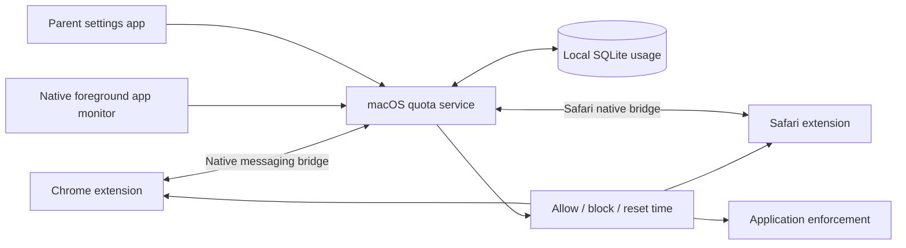

# kids-quota

Shared weekly website and application time allowances for macOS, with Chrome and
Safari support.

**Status:** project specification and architecture. No application or blocking
extension has been implemented or installed yet.

## Product requirements

- Configure a weekly allowance in hours for a group of domains and selected Mac apps.
- Share each allowance across Chrome, Safari, and associated standalone apps for
  the same macOS user. For example, Chess.com gets six hours total per week.
- Block the group's websites and selected apps when its allowance is exhausted,
  including open tabs and already-running apps, using the relevant enforcement adapters.
- Reset automatically on a configurable weekday, defaulting to Monday at 00:00.
- Keep settings and usage on the Mac; no cloud account is needed for the initial version.

## Recommended approach

Use a Swift macOS app and quota service with Chrome and Safari browser extensions.
The extensions know the actual page hostname, even when the connection is HTTPS.
The native app monitor identifies the frontmost selected application. The service
owns the shared balances, calendar boundaries, and persistent state, and counts
each foreground interval once. Browser and application enforcement adapters apply
the same quota decision.

This avoids treating a shared CDN IP address as a website. DNS or a network filter
can supplement enforcement, but neither alone tells us how long a child is viewing
a particular page.

## Proposed defaults

| Setting | Default |
| --- | --- |
| Reset | Monday, 00:00 |
| Timezone | Selected during setup; stays fixed until changed |
| Metering | Matching browser tab or selected standalone app in the foreground, while awake and unlocked |
| Passive viewing | Counts, including foreground video without mouse or keyboard activity |
| Background tabs and audio | Do not count in the first version |
| Domain matching | Exact hostname plus subdomains, configurable per entry |
| App matching | Explicit parent selection and verified application identity |
| Unused time | Does not carry over |
| Scope | One Mac; separate balances per macOS user |

See [the architecture](docs/architecture.md) for enforcement limits, timing rules,
and an implementation sequence. [The example policy](config/example-policy.json)
illustrates the intended configuration; it is not an executable configuration yet.

## Shared Chess.com quota

One rule named **Chess.com** has a six-hour weekly allowance. Its members are
`chess.com` and subdomains, plus the installed Chess.com app selected by the parent.
Two hours in Chrome, one hour in Safari, and two hours in the app consume five
hours, leaving one hour for any of them. An open background tab does not add time
while the app is foreground. Monday's reset refreshes this single shared balance.

The example deliberately leaves the app identity unconfigured: the actual installed
app must be inspected and bound during setup. No Chess.com bundle or signing ID is
assumed. Standalone web apps with shared browser executables require a site-specific
adapter rather than attaching the entire browser to the quota.

## Initial delivery milestones

1. A tested Swift quota core: domain and app membership, usage accounting, week
   boundaries, persistence, and policy validation.
2. A vertical slice in both Chrome and Safari: active-domain reporting, shared
   balance, a time-remaining display, and an exhaustion page.
3. Native app selection and foreground tracking against the same balance; validate
   network blocking, running-app handling, and relaunch prevention separately.
4. A macOS settings app, signed packaging, startup integration, and permission setup.
5. An enforcement review for child accounts, extension management, private
   browsing, Network Extension integration, and offline app controls.

The initial browser-based implementation will require enabled extensions and
granted website access. It is not a guarantee against deliberate bypass on an
unmanaged Mac.
