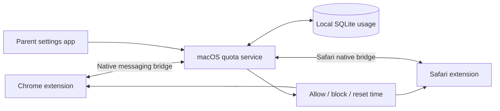

# kids-quota

Weekly website time allowances for macOS, with Chrome and Safari support.

**Status:** project specification and architecture. No application or blocking
extension has been implemented or installed yet.

## Product requirements

- Configure a weekly allowance in hours for each website or explicit domain group.
- Share each allowance across Chrome and Safari for the same macOS user.
- Block the website when its allowance is exhausted, including open tabs.
- Reset automatically on a configurable weekday, defaulting to Monday at 00:00.
- Keep settings and usage on the Mac; no cloud account is needed for the initial version.

## Recommended approach

Use a Swift macOS app and quota service with Chrome and Safari browser extensions.
The extensions know the actual page hostname, even when the connection is HTTPS.
The service owns the shared balances, calendar boundaries, and persistent state.
Extensions enforce the service's decision in their respective browsers.

This avoids treating a shared CDN IP address as a website. DNS or a network filter
can supplement enforcement, but neither alone tells us how long a child is viewing
a particular page.

## Proposed defaults

| Setting | Default |
| --- | --- |
| Reset | Monday, 00:00 |
| Timezone | Selected during setup; stays fixed until changed |
| Metering | Selected tab in the frontmost browser, while the session is awake and unlocked |
| Passive viewing | Counts, including foreground video without mouse or keyboard activity |
| Background tabs and audio | Do not count in the first version |
| Domain matching | Exact hostname plus subdomains, configurable per entry |
| Unused time | Does not carry over |
| Scope | One Mac; separate balances per macOS user |

See [the architecture](docs/architecture.md) for enforcement limits, timing rules,
and an implementation sequence. [The example policy](config/example-policy.json)
illustrates the intended configuration; it is not an executable configuration yet.

## Initial delivery milestones

1. A tested Swift quota core: domain matching, usage accounting, week boundaries,
   persistence, and policy validation.
2. A vertical slice in both Chrome and Safari: active-domain reporting, shared
   balance, a time-remaining display, and an exhaustion page.
3. A macOS settings app, signed packaging, startup integration, and permission setup.
4. An enforcement review for child accounts, extension management, private
   browsing, and optional Network Extension integration.

The initial browser-based implementation will require enabled extensions and
granted website access. It is not a guarantee against deliberate bypass on an
unmanaged Mac.
