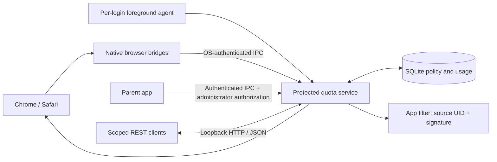

# kids-quota

Weekly website and Mac app allowances shared across Chrome, Safari, and selected
apps, with independent balances for children using separate macOS login accounts.

**Status: implemented development release.** The Swift service, SQLite ledger,
parent app, browser adapters, native messaging hosts, and Network Extension build
locally. Unit tests and an isolated live service test cover accounting and policy
behavior. Signed installation and real browser/network-filter enforcement need
on-device acceptance checks before this is relied on as parental control.

## Features

- Starts each linked child with **Chess.com: 6 hours/week** and **ChatGPT: 6
  hours/week**. Each service shares its balance between websites and selected apps.
- Adds custom domain groups, optional subdomains, and optional Mac apps. Choose
  an installed app with the standard picker; the service verifies its signature.
  App paths and names alone never grant a match.
- Counts the foreground website or app while the child's session is awake and
  unlocked, including passive viewing. Background use does not consume time.
- Blocks website navigation and replaces open matching tabs at exhaustion.
  The Network Extension denies selected apps' network traffic for that child.
  Apps can still launch and use cached/offline features.
- Resets Monday at 00:00 by default in the saved timezone. Weekday/time/timezone
  are editable; schedule changes take effect after the current period. Handles
  DST, sleep, restarts, and clock rollback.
- Provides a parent-only **Reset this week** button. It restores the selected
  child's current-week balances, preserves their limits and next reset date, and
  records an audit event. Other children and earlier weeks are untouched.
- Exposes authenticated `http://127.0.0.1:48123/v1` JSON endpoints for widgets or
  local publishers. Revocable read tokens have explicit child grants. No client
  endpoint can post usage or set remaining balances.

The parent app opens directly to the child's remaining-time cards, with a child
picker when multiple accounts are linked, **Edit hours**, **Includes**, custom
services, and settings for protection, resets, and clients.
Service membership is shared; hours belong to the selected child. Website-only
services need no app selection. Presets do not guess app identities: use **Manage
included websites and apps → Choose app** to include the installed app.

## Install and set up

The signed release is distributed as **KidsQuota-<version>.dmg**:

1. Mount the DMG and open **Install Kids Quota.pkg**. The macOS Installer requests
   administrator permission and installs the app and background components.
2. Open **Kids Quota** from Applications in your parent/administrator account.
   Choose **Unlock parent settings** to authorize configuration with macOS administrator credentials.
3. Select the child's existing standard Mac login account and choose
   **Set up account**. Chess.com and ChatGPT are created automatically,
   each with six hours per week and a Monday reset. No token entry or terminal is needed.
4. Complete the browser-extension and app-filter approval prompts shown in the app.
   macOS/browser permission prompts cannot be silently accepted by an ordinary installer.

The installed parent executable is `root:admin` with mode `0750`; a standard child
cannot read or execute it. Its embedded browser/filter extensions remain accessible
so enforcement can run in the child's account. The parent UI starts locked, clears
its credentials on lock/close, and uses Authorization Services; the root daemon
independently verifies the administrator's OS identity and authorization on every
configuration request. The GUI itself does not run as root.

The REST listener is **read-only**, even with an administrator bearer token.
Configuration and resets require the authenticated parent IPC connection. A copied
app or HTTP request from the child cannot change thresholds.

This checkout includes the release packaging tools. Producing a real installable
DMG still requires Developer ID Application and Installer signing certificates;
the instructions-only preview image is not an installer. See [deployment](docs/deployment.md).

## Build and test

Requires macOS 14+, full Xcode, Node 20+, and [XcodeGen](https://github.com/yonaskolb/XcodeGen).
Uses system SQLite; no third-party Swift/JavaScript runtime dependencies.

```sh
export DEVELOPER_DIR=/Applications/Xcode.app/Contents/Developer
swift test
npm test
python3 -m unittest discover -s Tests/packaging
npm run build:extensions
xcodegen generate
xcodebuild -project KidsQuota.xcodeproj -scheme KidsQuotaMacTests \
  -destination 'platform=macOS' -derivedDataPath .build/xcode \
  CODE_SIGNING_ALLOWED=NO test
python3 scripts/smoke-service.py
```

The smoke test starts an unprivileged localhost service in a temporary directory,
checks HTTP authorization, rejected configuration writes, native-peer rejection, and crash recovery, then
stops it. It never installs a launch service or activates filtering.

See [macOS build details](docs/macos-build.md) and [signed deployment](docs/deployment.md).
Generated adapters are `extensions/build/chrome` and `extensions/build/safari`.

To run a development daemon without installing anything:

```sh
swift build
BIN_DIR="$(swift build --show-bin-path)"
mkdir -p work/dev-data
"$BIN_DIR/kids-quota-service" --development \
  --data-dir "$PWD/work/dev-data" --socket /private/tmp/kids-quota-dev.sock
```

Development mode weakens native-peer verification and is for testing only.
Production installation rejects unsigned binaries and runs as root with protected data.

## Admin installation and removal resistance

The installer places the daemon, native hosts, app, and launch configuration in
administrator-controlled locations. A standard child cannot edit the ledger or
replace these files. If a collector disappears, known services block after their
freshness lease expires rather than continuing with unlimited time.

Unpacked Chrome or manually enabled Safari extensions remain removable/disableable.
Managed Chrome forced-install policy and Safari extension management can enforce
enablement; templates and requirements are in [deployment](docs/deployment.md).
This is a deployment choice, not a change to the quota architecture. Children
must use standard accounts.

## Architecture



Domain matching uses hostnames, label boundaries, IDNA normalization, and a bundled
Public Suffix List, independent of DNS answers and IP addresses. The daemon selects
one foreground activity, avoiding double charging. Native reports use OS credentials;
stored account GUIDs are revalidated so a reused UID cannot inherit another child's quota.

## Validation and limits

- Automated suites cover calendar boundaries/DST, shared usage, persistence,
  child isolation, revocation, revisions, request parsing, domain matching, stale
  adapters, app-rule isolation, and native presentation. See [validation](docs/validation.md).
- A Developer ID certificate, matching provisioning/entitlements, and macOS
  approval are required for the Network Extension. This repository has not
  installed or activated protection on your Mac.
- Run signed acceptance checks on each target macOS/browser version, including
  Safari's native socket sandbox exception, existing TCP/UDP flows, screen lock,
  wake, account switching, and the actual selected apps/helpers.
- Browser measurement is the foreground **top-level** website. Embedded services,
  other browsers, browser web-app wrappers, and unselected helpers may need added
  coverage. Unsupported attribution is surfaced as incomplete.
- A filter starting without the service has no initial rules; in-memory
  fail-closed behavior requires a previously received policy. Restart apps after
  initial filter activation to cover sockets opened before activation.
- One Mac only. DNS proxy enforcement, offline app denial, automatic app-signature
  catalogs, multi-Mac pooling, a widget, and a hosted publisher are follow-on work.
  The REST API supports independent read clients now.

## Reference

- [API behavior](docs/api.md) and [OpenAPI 3.1](api/openapi.yaml)
- [Architecture and acceptance criteria](docs/architecture.md)
- [Service UX and future catalog behavior](docs/service-setup-ux.md)
- [Example household policy](config/example-policy.json) (illustrative unpaired accounts)
- [Read-client example](examples/read_balances.py)
- [Third-party notices](THIRD_PARTY_NOTICES.md)
