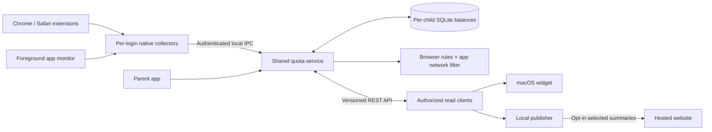

# kids-quota

Weekly website and app allowances for multiple children on macOS, with Chrome and
Safari support and an open HTTP API for additional clients.

**Status:** project specification, example configuration, and API contract. The
app, quota server, network filter, and browser extensions are not implemented yet.

## Product requirements

- Give each child independent weekly allowances, linked to their separate macOS
  login account. Using or exhausting one child's time never affects another child.
- Start with Chess.com and ChatGPT, each at six hours per week for each child.
- Add other websites and named domain groups through the UI or authorized API.
  A group can contain multiple domains and optional selected Mac apps.
- Share a child's service balance across Chrome, Safari, and its selected apps.
- At exhaustion, extensions block the websites and replace open matching tabs;
  a macOS Network Extension cuts network access for that child's selected apps.
- Apps may still launch and use cached/offline features. App termination and
  launch prevention are outside the agreed initial scope.
- Reset on a configurable weekday, default Monday at 00:00 in the configured timezone.
- Keep authoritative settings and usage on the Mac; no cloud account is required.
- Expose a documented, versioned REST API for widgets and other clients, including
  a future publisher that reads balances and sends selected summaries to a website.
- Keep the parent UI simple: child selector, service rows, remaining time, clear
  coverage status, **Edit hours**, **Add website**, and a shared reset setting.

## Architecture

A protected machine-wide Swift service owns balances, policies, and SQLite state.
Per-login collectors report the foreground browser domain or selected app. The
service maps the authenticated macOS account to its child profile and counts each
foreground interval once. Filter rules use both source-app identity and the
originating account, so the same app can be blocked for one child and available
for another.

The HTTP API initially listens only on loopback and requires a scoped credential.
Read clients can access only the children the parent grants them. Separate parent
authorization permits policy changes. Generic clients cannot submit usage or set
balances; trusted local collectors remain responsible for accounting.

A hosted website cannot call the Mac's localhost API directly. A publisher running
on the Mac can read the API and upload selected summaries. A remote API gateway
would be a later feature with authenticated encrypted access. This design does not
open a network listener or publish children's data now.

## Defaults and scope

| Setting | Default |
| --- | --- |
| Children | Separate macOS login accounts, explicitly linked during setup |
| Chess.com | 6 hours per child, shared across website and selected app |
| ChatGPT | A separate 6 hours per child, shared across website and selected app |
| Other websites | Add a hostname/group and choose its allowance for each child |
| Reset | Monday, 00:00; shared household timezone and reset schedule |
| Metering | Matching foreground tab or app while the session is awake and unlocked |
| Passive viewing | Counts, including foreground video without keyboard or mouse input |
| Background use | Does not consume foreground time; exhausted apps remain network-blocked |
| Unused time | Does not carry over |
| Initial deployment | One Mac with multiple children; no automatic pooling across Macs |
| Additional clients | Authenticated HTTP/JSON API with child-scoped access |

For a child, two hours of Chess.com in Chrome, one in Safari, and two in the native
app consume five hours and leave one hour. That child's ChatGPT balance and every
other child's balances remain unchanged. Having the site open behind the app does
not count twice.

Parents can add a service such as **Reading** with `example.org` and subdomains,
then give different allowances to different children. Service membership is shared
configuration; allowances and usage are per child. Adding or editing a domain must
surface any new browser permission needed before claiming full coverage.

The example uses placeholder children and unconfigured OS/app bindings. Setup must
verify the real accounts and installed apps. No account or app identifiers are
guessed. Shared browser executables need site-specific attribution and must not
be bound wholesale to a service.

## Simple interface

The main screen starts with a **Child** selector. Below it, show that child's
service rows, initially **Chess.com** and **ChatGPT**. Each row has remaining time,
a used-time progress bar, and **Available**, **Weekly limit reached**, or **Setup
needed**. Selecting a different child changes the view only, never the identity
charged by the collectors.

**Edit hours** changes the selected child's allowance. **Add website** asks for a
friendly name, one or more domains, and weekly hours; optional app selection is an
additional detail. **Manage children** links the children's existing macOS accounts.
Show the next reset once below the list, with a simple day/timezone setting.

Coverage details show Chrome, Safari, and optional app setup. Use **Website blocked
until [reset]** and **App internet access blocked until [reset]** at exhaustion.
Incomplete account mapping, permissions, or filtering must never appear protected.
Advanced **Connected clients** settings manage read access, allowed children, and
revocation without adding API details to the everyday quota screen.

## Documents

- [Architecture and acceptance checks](docs/architecture.md)
- [HTTP API and client access](docs/api.md)
- [OpenAPI contract](api/openapi.yaml)
- [Example family policy](config/example-policy.json)
- [Custom website creation example](config/custom-service.example.json)

The custom-service request uses a placeholder revision of zero. Replace it with
the latest `policyRevision` from an authorized read before submitting the request.

## Implementation sequence

1. Quota core and persistence: custom domains, child/account mapping, per-child
   allowances, usage, calendar boundaries, and API resource validation.
2. Authenticated REST read API and parent policy endpoints, checked against the
   OpenAPI contract, with child isolation and fresh balance snapshots.
3. Chrome and Safari reporting/blocking plus native foreground-app metering;
   reconcile login, logout, fast user switching, sleep, and reconnection.
4. Network Extension app blocking by source account and app identity, including
   verified helpers, existing flows, and recovery at reset.
5. Simple parent UI, signed packaging, guided setup, and tamper-resistance review.
6. Follow-on widget and publisher clients using the same API; no separate balance store.

Enabled extensions, granted permissions, and functioning app filters are required.
The initial design does not guarantee enforcement against deliberate bypass on an
unmanaged Mac.
