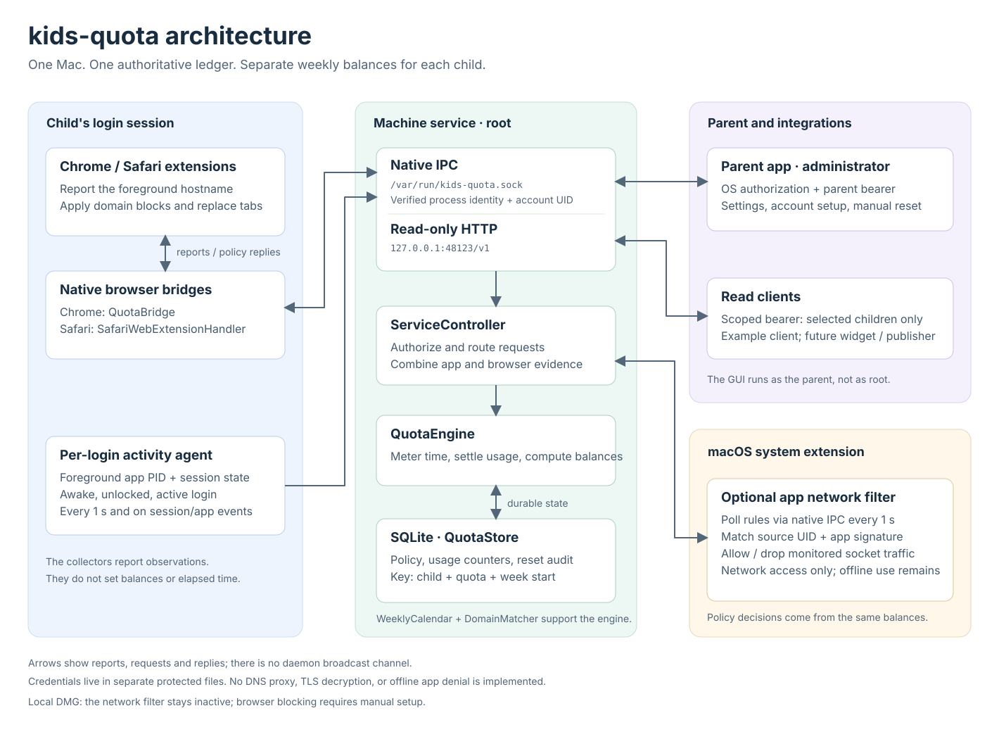

# Architecture and acceptance criteria

This document records the design and acceptance criteria. The development release
implements the core components; [README](../README.md) distinguishes implemented
behavior from signed runtime checks and later features.

## Runtime diagram

The [SVG](architecture.svg) shows the current implementation on one Mac. The
[Mermaid version](architecture.mmd) is an editable structural view of the same
components. For a source-by-source tour, read the [code walkthrough](code-guide.md).

| Connection | What actually travels over it |
| --- | --- |
| Extension → native browser bridge → daemon | Active hostname, focus, session ID, and sequence number; the reply carries domain rules and remaining time. Browser refreshes are event-driven plus a roughly five-second timer while running. |
| Per-login agent → daemon | Frontmost PID and awake/unlocked/active-session observations, every second and on relevant events. The daemon verifies identity and resolves the child. |
| Parent app ↔ daemon | `parentHTTP` envelopes over authenticated UNIX IPC, with OS administrator authorization and a bearer token. Configuration does not use the public HTTP listener. |
| Read client ↔ HTTP listener | Scoped bearer-authenticated reads at `127.0.0.1:48123/v1`, restricted to explicitly granted children. |
| App filter ↔ daemon | A `filterRules` poll every second, returning blocked states associated with child UIDs and verified app requirements. The filter enforces those decisions on socket flows. |
| Engine ↔ SQLite | Policy, per-child/per-quota/per-period counters, period floor, and reset audit. API credentials are separate protected files. |

The central boxes are modules inside one service process. Browser bridges, the
login agent, the parent GUI, and the network extension run separately. The service
does not push unsolicited rules to adapters: they receive updated state through
request/reply exchanges. Neither an extension nor the filter owns a balance.

The current [local DMG](local-install.md) keeps the optional network filter
inactive. Its service uses root-protected code-hash pins instead of an Apple
Team ID for native-client authentication. Browser quotas and parent controls
remain, while selected native apps are tracking-only.

## Services and children

- **Chess.com:** `chess.com` and subdomains, plus the selected Chess.com Mac app,
  share a six-hour weekly allowance.
- **ChatGPT:** `chatgpt.com` and subdomains, plus the selected ChatGPT Mac app,
  share a separate six-hour weekly allowance.

These are starter services, not a fixed allowlist. A parent can create additional
named service groups with one or more domains, optional subdomain matching, and
optional selected apps. Each child receives independent quotas for the services
assigned to them; the initial Chess.com and ChatGPT allowances are each 21,600
seconds per child. Changing one child's allowance never changes a sibling's.

The first release supports multiple children on one Mac, each using a separate
macOS login account. It does not automatically synchronize or pool usage across
multiple Macs. Parent-facing child names are labels, not authentication identities.

Chrome and Safari extensions enforce website quotas. A macOS Network Extension
content filter cuts off network access for the selected apps at exhaustion. The
apps may remain open and their cached or offline features may continue working.
App termination, launch prevention, and Endpoint Security are outside this scope.
DNS filtering is optional and is not required for the initial enforcement design.

## Why domain identity belongs in the browser

An extension can read a permitted tab's URL and extract its hostname before any
DNS-to-IP mapping matters. HTTPS does not hide the URL from the browser itself.
The quota is associated with the top-level site being viewed, not every analytics,
advertising, or media host contacted by that page.

Chrome supports tab access, declarative request blocking, and communication with
a native host. Safari Web Extensions provide their own native messaging bridge.
Use shared extension logic where compatible, with platform-specific adapters and
capability checks. Do not assume complete Chrome/Safari API parity.

Sources: [Chrome permissions](https://developer.chrome.com/docs/extensions/develop/concepts/declare-permissions),
[Chrome request rules](https://developer.chrome.com/docs/extensions/reference/api/declarativeNetRequest),
[Chrome native messaging](https://developer.chrome.com/docs/extensions/develop/concepts/native-messaging),
[Safari native messaging](https://developer.apple.com/documentation/safariservices/messaging-between-the-app-and-javascript-in-a-safari-web-extension).

## Components and authority

- **Swift macOS app:** parent settings, children, weekly hours, domain/app groups,
  reset day and timezone, and remaining time. Keep
  the main view simple: a child switcher, one row per assigned service with
  used/remaining time and blocking state, an hours editor, an **Add website or
  group** action, and one shared reset setting. Put client connection settings in
  a separate settings view. Show incomplete setup plainly.
- **Quota service:** one protected machine-wide daemon owns account mappings,
  policy, API credentials, and balances. Per-user collectors report to this daemon;
  they cannot maintain competing authoritative copies of a child's balance.
- **SQLite store:** validated policies and durable usage indexed by stable
  `childId`, `quotaId`, and calendar-period start. Store protected account bindings
  separately from child display names. Do not store page contents or full URL history.
- **HTTP API:** a versioned, authenticated JSON interface allows independently
  developed clients to read permitted balances. Configuration uses the shared
  schemas over administrator-authorized native IPC. HTTP cannot mutate policy.
- **Browser adapters:** report the selected top-level hostname and focus changes,
  receive remaining time and deadlines, and apply blocking. A Chrome native host
  and Safari native app-extension bridge both connect to the same service.
- **Native app monitor:** observes the frontmost application and resolves its
  verified identity to an explicit application binding. Reports activity to the
  same quota service; a running background process does not imply use.
- **Application network filter:** a Network Extension content filter applies an
  exhausted group's policy to traffic from its selected apps and explicitly bound
  helper processes, scoped to the originating child/account. It handles new flows
  and existing connections, independently
  of whether an app is foreground, background, already running, or newly launched.
  It does not prevent launch or stop offline app features.

Browser/native messages must be versioned, bounded, and restricted to the intended
extension and authenticated OS-session identities. Do not expose an unauthenticated
localhost control server.
Policy updates require parent authorization in the intended product, not merely
a browser message. A parent PIN alone is not an OS-level security boundary.

## Child identification and account isolation

During parent-authorized setup, bind a stable child ID to the selected macOS
account's durable directory identity. Resolve that binding to the account's current
UID at runtime; a display name, login-name string, reusable UID alone, or request's
claimed `childId` is insufficient identity. Account deletion/recreation requires
binding review rather than inheriting a previous child's quota accidentally.

Authenticate collector IPC using the connecting process's OS credentials/audit
identity and expected code identity. The daemon derives the child from that
verified session and its stored account binding. A collector in one account cannot
charge another child or change its own mapping. An unbound account reports setup
needed and must not be silently assigned to another child's balance.

Fast user switching pauses metering for the session losing interactive foreground
ownership. On switching, login, logout, lock, and wake, reconcile the active session
and its foreground app/tab before resuming. A browser left running in another
login session is background activity, not additional foreground use.

Network enforcement must resolve both the verified source app and originating
user. Exhausting one child's ChatGPT allowance must not block the same installed
ChatGPT binary for a sibling or parent. Keep per-account rules and test system
helpers that open connections on an app's behalf. Unknown attribution is an
explicit coverage gap, never a reason to apply a machine-wide app ban.

## Open HTTP interface and additional clients

Use the loopback endpoint `http://127.0.0.1:48123/v1` with JSON resources
for children, services, per-child quotas, and balances. Parent administrative
routes also manage verified account/app selection, reset settings, and read tokens.
The parent UI uses root-authenticated UNIX IPC so a process occupying the HTTP
port cannot impersonate the daemon and harvest its administrator token. Its executable
is restricted to root/admin users, and each native parent request requires a
current `system.privilege.admin` Authorization Services grant and an administrator
peer UID. The GUI stays unprivileged; the daemon performs privileged changes. See
[API behavior](api.md) and the [OpenAPI contract](../api/openapi.yaml).

Require credentials even on loopback because other local accounts and applications
can reach it. Parent-paired, revocable clients receive only their necessary scopes
and an explicit child allowlist. Read scopes such as `balances:read` grant no policy
editing or usage submission; the parent needs `policy:write` plus OS authorization
on the authenticated native connection for mutations. HTTP is read-only even when
presented with a parent token.
Authorize every requested object and filter collections to the allowed children.
Never return a sibling's record just because its ID is known. Store credentials
outside public website code and protect them with the client's OS account.

Trusted activity collectors continue to use authenticated native IPC. The public
REST contract has no endpoint that accepts arbitrary elapsed seconds or writes a
balance. Adding a new measurement client later requires a defined trust and
registration protocol, not an ordinary balance-reading token.

Balance responses include the child's current period boundaries, an `asOf`
timestamp, the policy revision, limit/used/remaining seconds, quota state, and
separate enforcement-coverage status. The service includes current live elapsed
usage in the snapshot rather than waiting for a disk checkpoint. A widget polls
when it refreshes and clearly labels stale or disconnected data; it cannot promise
an always-live countdown or enforcement state from a cached response. Private
responses use `Cache-Control: no-store`; clients receive summaries, not browsing
history or page contents.

A local publishing client can read selected balances and, when explicitly enabled
by the parent, send chosen summaries to a separately hosted website. That website
cannot directly reach the Mac's loopback API. Do not put a parent/API credential
into public JavaScript or publish child identities or balances automatically.
Remote API access, if added, needs a separately paired TLS-protected gateway; the
initial service must not simply bind to all network interfaces. No cross-device
quota synchronization is implied by having multiple API clients.

## Shared website and application quotas

A shared service definition has a stable `id`, `name`, `domains`, and
`applicationIds`. Each child has separate quota records with stable IDs, a
`serviceId`, and `weeklyLimitSeconds`. The ledger belongs to the child/quota/period,
not the service catalog entry or the client reading it. Service members never
receive separate copies of the allowance.

Each child's starter `chesscom` quota has six hours per week shared by `chess.com`
and subdomains in Chrome/Safari, and the explicitly selected installed Chess.com app.
Two hours in Chrome plus one in Safari plus two in the native app use five hours,
leaving one hour. Exhaustion and the Monday reset apply to the entire group.
The separate `chatgpt` group applies the same model to `chatgpt.com` and the selected
ChatGPT Mac app, with its own six-hour allowance and balance. Using or exhausting one
service does not change the other service's balance or access. Nor does it change
any other child's balance, even when they use the same service and app installation.

Editing a catalog service's domain/app membership affects every child assigned
that service; the parent UI shows that scope before saving. Existing quota IDs and
usage are preserved. To give a child a different membership group, create a separate
service definition and assignment. Validation rejects overlapping assigned service
selectors for the same child, while different children may have different rules.

Policy `applicationIds` reference logical IDs in `applicationBindings`; those IDs
are internal references, not claimed bundle identifiers. The example's
`chesscom-macos` and `chatgpt-macos` bindings have `status: needs-selection` and
`identity: null` because the actual apps have not been inspected. A production
policy may retain those drafts, but must surface incomplete app coverage and
cannot claim to restrict the app
until binding and enforcement setup succeed. Missing identities never match all apps.

During setup, the parent selects the installed app. Record and verify its signing
identity, including a suitable code-signing requirement and signing identifier;
do not rely on the display name, filename, installation path, or PID as identity.
Resolve legitimate helper processes as part of a tested app-specific binding;
never allow a broad vendor identity to capture unrelated apps or shared processes.
Updates that satisfy the stored identity preserve the binding and usage; identity
changes require review rather than silently losing coverage. Reject unresolved
application ID references and duplicate verified identities under different bindings.
Reject overlapping app membership across quota groups assigned to the same child.

Associate apps with services explicitly. An app making a request to `chess.com`
does not establish that all its foreground time is Chess.com use. Selecting an
app means its entire foreground use counts, including its offline features.
General browsers must use the domain adapter rather than whole-app membership.
Safari web apps and Chrome-installed web apps may share executable identities with
their browser or other sites; require a distinct, verifiable site/app registration
or report unsupported coverage. Never bind all browser processes to either service.

Sources: [Foreground application](https://developer.apple.com/documentation/appkit/nsworkspace/frontmostapplication),
[Code Signing Services](https://developer.apple.com/documentation/security/code-signing-services).

## Domain matching

Parse URLs using a URL parser, canonicalize hostname case, trailing dot, and IDNA,
and compare DNS labels rather than arbitrary substrings.

For an entry `chess.com` with `includeSubdomains: true`, match the normalized
hostname when it equals `chess.com` or ends with `.chess.com`. Apply the same
label-boundary rule to `chatgpt.com`.

- Matches: `chess.com`, `www.chess.com`, and other subdomains.
- Does not match: `notchess.com`, `chess.com.attacker.example`.
- Additional aliases require an explicit service-specific policy entry. Do not
  include all of `openai.com` or shared authentication/CDN domains in ChatGPT's
  website quota merely because the service contacts them.
- Reject IP literals, schemes, paths, empty names, public-suffix-only entries such
  as `com` or `co.uk`, and overlapping assigned rules for a child that would make
  quota attribution ambiguous.
- Support explicit related-domain groups; do not infer site ownership from IPs.

Custom domain additions use the same validation and matching pipeline as starter
services. Request or verify the required permissions in every enabled browser
profile before reporting complete website coverage. A website-only service is
valid: application membership is optional. A configuration write alone must not
claim that missing browser permissions have been granted.

Blocking a site's navigation should not globally block a shared CDN just because
that site uses it. Third-party embeds, alternate domains, installed web apps, and
picture-in-picture need a defined policy before claiming coverage.

## What counts as time

While the macOS session is unlocked and awake, resolve the foreground activity to
either the selected top-level tab in the frontmost supported browser or a bound
standalone application. Use OS foreground/session state to arbitrate across apps,
browsers, and windows; a tab's `active` flag alone is insufficient.

Passive foreground viewing counts. A lack of keyboard or mouse activity must not
stop the clock for a video. Background tabs and background audio do not count in
the initial scope. This is a stated policy limitation, not an inference that the
child has stopped consuming the content. An abandoned foreground page or paused
video still consumes time. Picture-in-picture and background playback are not
covered by this foreground-only measurement.

The native service owns elapsed-time accounting using a monotonic clock. Browser
navigation and focus events update the current activity, with bounded heartbeats
for liveness. Do not depend on a Manifest V3 worker's `setInterval` remaining alive.
Resolve the actual current tab on startup, wake, reconnection, and focus changes.
Also reconcile the current foreground application on those transitions. Do not
infer that an old tab or application stayed active through a long unobserved interval.

Charge at most one foreground activity for the interactive child at a time. Persist
short increments transactionally and settle on transitions. Identify duplicate/out-of-order events
with session IDs and sequence numbers. Target a small documented overshoot bound
and measure it under suspension and disconnects before promising timing precision.
For a browser-to-app transition within the same quota group, settle the previous
activity and continue the same balance. Deduplicate simultaneous reports from web
and native adapters. A browser left open behind the app cannot charge a second
interval, and background network requests do not create usage intervals.

## Parent reset and weekly reset

The unlocked parent app offers **Reset this week** for the selected child. The
daemon settles current observed elapsed time, resets only that child's current
period counters, increments revision, and records a private audit event in one
transaction. Limits, the next scheduled reset, earlier periods, and siblings stay
unchanged. A stale revision cannot repeat the reset. Public HTTP callers and
collectors cannot authorize this action.

The household-wide default boundary is Monday 00:00 in the policy's named IANA
timezone. Select the timezone during setup, then store it explicitly. The example
uses America/Chicago. Children share that schedule, not balances or allowances.

Compute the most recent and next calendar boundary, not an elapsed 604,800-second
timer. Weeks spanning daylight-saving transitions are not always 168 hours.
Use half-open periods `[start, nextStart)` and split a usage interval at a boundary.
Define non-existent local midnight as the next valid instant and repeated midnight
as its first occurrence, with tests for the supported calendar implementation.

Recompute the current period on startup, wake, policy checks, and quota queries.
A reset must work even when the Mac was asleep at the boundary. New periods begin
with fresh allowance; old usage can remain for local summaries. Old-period blocking
rules must be reconciled before browsing is allowed or denied in the new period.

Reset-schedule changes should take effect at the next existing boundary. Keep the
current period intact so repeatedly changing the weekday cannot mint new hours.
Allowance edits apply to the current period without discarding already-used time.
Lowering an allowance below time used blocks immediately. Changing device timezone
does not change a policy's saved timezone. Domain, application membership, and
display-name edits preserve the quota's stable ID and usage; deleting and recreating a quota is an explicit
parent-authorized policy change.

Clock rollback must not revive an older balance. Persist period transitions and
detect discontinuities. Large forward clock changes can still grant a new period
without a trusted time source; stronger resistance requires deployment controls or
a separately designed trusted-time policy.

## Exhaustion and recovery

When remaining time reaches zero, the extension should:

1. Apply domain-based rules for new navigations and relevant requests.
2. Navigate already-open matching tabs to its own local exhaustion page, stopping
   already-loaded content and buffered playback.
3. Show the quota name and next reset time without exposing sensitive URL details.
4. Reconcile rules after reset, extension startup, reconnection, and policy changes.

Request filtering alone does not remove already-rendered content. Verify cached
pages, browser back/forward restoration, service workers, and existing media.
Safari's supported blocking APIs and timing must be verified on the chosen minimum
macOS/Safari versions in the first vertical slice.

Proposed service-unavailable behavior: existing exhausted rules remain, and known
restricted domains get a temporary unavailable page after a short grace interval.
Unrestricted browsing remains available. This requires the extension to be running;
it cannot guarantee enforcement if the extension is removed or disabled.

The same exhausted quota decision must reach the application's Network Extension
content filter with its child/account scope. Match flows using verified source-app
identity and tested helper attribution; do not try to discover every API or CDN
domain used by the native app.
This app-specific denial applies to its network traffic regardless of the target
IP, hostname visibility, or whether the app uses its own DNS implementation. No
TLS decryption is part of the design.

At exhaustion, reevaluate tracked existing flows as well as deny new ones. An app
may already have an active game connection, streaming response, WebSocket, or
other long-lived session. Verify TCP and UDP/QUIC behavior and bound the time until
further traffic is blocked; a rule applying only to newly opened connections is
insufficient. Validate helper/source-app attribution and report coverage gaps.
Confirm that the chosen flow-verdict strategy retains control of ongoing flows
before claiming that already-established connections are covered.
Buffered responses or locally stored content can remain visible after network
traffic stops; the filter does not erase content or stop offline computation.

On reset or an authorized allowance increase, reconcile the app filter and browser
rules against the same current quota state. Fresh app connections should work
again; apps may need to retry connections that were denied. Preserve exhausted
app rules across service restarts and report filter disconnection or disablement
as incomplete enforcement. Do not advertise app launch or offline-use blocking.

Sources: [Network source-app identity](https://developer.apple.com/documentation/networkextension/nefilterflow/sourceappaudittoken),
[Content filter provider](https://developer.apple.com/documentation/networkextension/nefilterdataprovider).

## Network Extension scope and optional DNS filtering

DNS filtering can refuse selected hostnames, but a lookup is not a measure of viewing
time. Cached DNS, established connections, and buffered or cached pages mean that
denying later lookups cannot immediately revoke all use. Apple's DNS proxy handles
port-53 DNS flows; an application's own DNS-over-HTTPS is not automatically an
ordinary DNS flow.

Network Extension is the primary native-app enforcement layer. Domain metadata
remains conditional: Apple's `NEFilterSocketFlow.remoteHostname` is populated
for create-by-name APIs, and `NEFilterBrowserFlow` is WebKit-specific. Do not claim
that a packet or socket filter always knows every Chrome request's domain. Native
app rules use app identity; browser rules use the extensions' known page domains.

macOS 26 URL filtering is worth a later feasibility check, but Apple's coverage is
WebKit and URLSession by default, with participation required from other stacks.
It also does not supply active-tab time accounting. Network extensions introduce
signing, entitlement, installation, and system-extension deployment work.

Sources: [DNS proxy](https://developer.apple.com/documentation/networkextension/nednsproxyprovider),
[Socket hostname](https://developer.apple.com/documentation/networkextension/nefiltersocketflow/remotehostname),
[Browser flow](https://developer.apple.com/documentation/networkextension/nefilterbrowserflow),
[URL filters](https://developer.apple.com/documentation/networkextension/url-filters),
[Deployment](https://developer.apple.com/documentation/technotes/tn3134-network-extension-provider-deployment).

## Child-account enforcement

Reliable deployment requires enabled extensions, website permissions, coverage of
all allowed browser profiles, and an explicit private-browsing policy. Switching
to an unsupported browser or disabling an extension can bypass a basic prototype.
A standard child account is useful but does not by itself prevent extension removal.
Evaluate browser management/MDM and application restrictions separately for Chrome
and Safari. A child with administrator control can defeat ordinary local controls.

Native Screen Time APIs should not be assumed to provide a cross-browser macOS
quota engine. Apple's native ScreenTime framework concerns an app's own web usage;
DeviceActivity platform availability is not equivalent to unrestricted native
macOS enforcement across browsers.

Sources: [ScreenTime](https://developer.apple.com/documentation/screentime),
[DeviceActivity](https://developer.apple.com/documentation/deviceactivity).

## Acceptance checks for implementation

- Correct exact/subdomain boundaries, IDNA, suffix validation, aliases, and overlap rejection.
- Custom domain groups work with optional apps, and missing browser permissions show incomplete coverage.
- Each child's independent Chess.com and ChatGPT quotas default to 21,600 seconds.
- Account binding uses durable identity and authenticated collector credentials; claimed child IDs cannot spoof attribution.
- Fast user switching, login/logout, and lock/wake change metering ownership correctly.
- Exhaustion for one child does not block the same app or website for siblings or the parent.
- Global service edits preserve all assigned children's usage and show their affected scope.
- Scoped API clients cannot read sibling balances or mutate policy with read-only credentials.
- Balance snapshots include live elapsed use, period boundaries, coverage, and freshness metadata.
- Widgets handle stale/disconnected state; a local publisher exports only parent-selected summaries.
- Multiple API clients do not duplicate usage or imply cross-Mac synchronization.
- Shared balance when switching between Chrome and Safari, profiles, windows, and tabs.
- Chess.com six-hour balance shared across Chrome, Safari, and its bound standalone app.
- ChatGPT six-hour balance shared across Chrome, Safari, and its bound standalone app.
- Each service exhausts and recovers independently; unrelated apps and sites remain accessible.
- Browser/app overlap charges once; running background apps do not consume foreground time.
- Verified app identity survives renaming and compatible updates; unresolved bindings show incomplete coverage.
- Shared browser executables do not accidentally match all sites as one standalone app.
- Exhaustion blocks browser access and the selected app's new and existing network flows.
- Test long-lived game/streaming connections, TCP, UDP/QUIC, and app helper attribution.
- Reset, allowance increases, wake, and restarts reconcile browser and app network rules.
- Cached/offline app use and app launches remain possible and are clearly described.
- No double charging; passive video counts; lock/sleep and excluded background use pause.
- Exhaustion stops an open page as well as fresh navigation; cached content is covered.
- Monday/custom-day boundaries, DST changes, wake after reset, and intervals across midnight.
- Crash/restart durability, duplicate messages, worker suspension, and service disconnects.
- Policy changes preserve usage; rollback does not restore already-spent allowance.
- Explicit observed behavior for private browsing, disabled extensions, and unsupported browsers.
