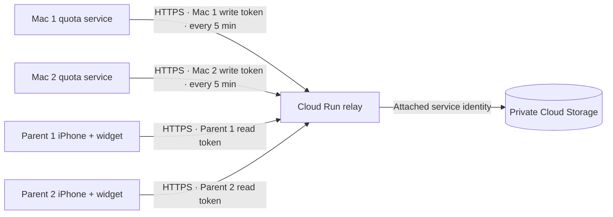

# Private phone dashboard relay

The iPhone app and widgets read a private family dashboard. Each configured Mac
uploads a summary every five minutes while it is online. A small Cloud Run service
authenticates those uploads and stores the latest summary for each Mac in Google
Cloud Storage. The storage bucket has public access prevention and uniform access;
it is never a public JSON feed. Phones authenticate to the relay with separate
read-only credentials. The Mac still owns every allowance and enforcement decision.

This is a deployment recipe, not evidence that a particular project is deployed.
Record an actual project, service URL, and verification result separately after
deploying. See [the shared JSON contract](phone-sync-contract.md) for payloads.

## Components and data



Only child display names, service names/domains, usage totals, remaining time,
period boundaries, and tracking status are uploaded. No visited URLs, page content,
messages, account IDs from macOS, application paths, or signing identities are sent.
Unknown payload fields are rejected, including fields in any child or quota entry.
A malformed upload rejects the entire update; it cannot remove a child silently.

Each Mac has its own independent ledger. Two children with the same display name
on different Macs remain separate dashboard entries. Combining their display does
not establish a shared enforced allowance across computers.

The relay stores one object per Mac. Object versioning and soft delete are disabled;
the lifecycle deletes an unchanged summary after 30 days. This is not usage history.
An unreported or expired Mac remains in the response with a null summary. Freshness
is based on the Mac's `capturedAt`, not the time the phone fetched a cached summary.
Treat a null summary as **No saved report**: it does not prove the Mac has never
connected, because an unchanged report expires after 30 days.
The widget marks data over 15 minutes old and never invents a countdown or reset.
iOS schedules widget refreshes; a request for 15-minute updates is not a guarantee.

## Provision private connections

Use Node 22 or newer. Choose an output directory outside this repository. It must
not exist yet, and its parent must exist. The example produces two Mac connections
and a separate read connection for each parent:

```sh
node scripts/cloud-provision.mjs \
  --out /private/tmp/kids-quota-family-connections \
  --family "Our family" \
  --device "Kids Mac 1" --device "Kids Mac 2" \
  --reader "Parent 1" --reader "Parent 2"
```

The directory is mode `0700` and files are `0600`. Pairing tokens are 256-bit random
base64url strings; plaintext tokens are never printed. `auth-config.json` contains
only SHA-256 digests and display names. The `mac-*.json` and `parent-*.json` files
contain secrets. Keep them out of Git, screenshots, public links, build artifacts,
and support logs. Keep a private backup if you need to pair another device later.

## Deploy to Google Cloud

The operator needs a Google Cloud project with billing enabled and permission to
enable APIs, create service accounts/buckets/repositories, and deploy Cloud Run.
The script requires `gcloud`, Node 22+, and an authenticated Google Cloud session.
It does not create a project, select a billing account, or change the active CLI
project. Create a dedicated project in the console first or explicitly:

```sh
gcloud projects create YOUR_PROJECT_ID --name="Kids Quota"
# Link the intended billing account explicitly before deploying.
```

After reviewing the chosen project and connection files:

```sh
scripts/cloud-deploy.sh \
  --project YOUR_PROJECT_ID \
  --bucket YOUR_GLOBALLY_UNIQUE_QUOTA_BUCKET \
  --region us-central1 \
  --auth-config /private/tmp/kids-quota-family-connections/auth-config.json
```

The script:

1. Validates the configuration before making cloud changes.
2. Enables Cloud Run, Cloud Build, Artifact Registry, Storage, and IAM APIs.
3. Creates a runtime service account and a separate build service account; no
   downloaded service-account key is created.
4. Creates private snapshot and build buckets. The runtime account can access only
   `snapshots/` objects in its snapshot bucket. The builder can access its staging
   bucket and write its Artifact Registry repository. Its build logs go only into
   that private staging bucket; it needs no project-wide logging role.
5. Builds `cloud/Dockerfile` on Cloud Build with an explicit Docker step,
   `GCS_ONLY` logging, and a ten-minute build timeout. A source allowlist sends only
   the Dockerfile, package metadata, and server source; private pairing files,
   tests, and Mac data are excluded. Existing CLI Kaniko preferences are ignored.
6. Deploys a public HTTPS entry point with application bearer authentication.
   `GET /healthz` is the only anonymous endpoint. Public invocation does not make
   the family API or storage public. The runtime has no project-wide storage role.
7. Limits Cloud Run to zero minimum instances, one maximum instance, 256 MiB RAM,
   one CPU, 20 concurrent requests, and a 30-second timeout.

Cloud Run, builds, storage, and network transfer can incur usage charges. Zero
minimum instances avoids keeping an idle instance running; it is not a spending
cap. Use the dedicated project's billing budget/alerts and avoid enabling new
services in an unrelated production project. Cloud Build artifacts and logs expire
after seven days; Artifact Registry images are retained until explicitly cleaned.

The script is intended for a dedicated project and buckets: on a repeat run it
reapplies the documented bucket lifecycle, versioning, and soft-delete settings.
Use only buckets created for this app. If IAM propagation causes an immediate
build/deploy permission error, inspect that error and retry after propagation;
do not grant Owner/Editor to either service account.

After deployment, set the actual HTTPS origin without rotating credentials:

```sh
node scripts/cloud-provision.mjs \
  --out /private/tmp/kids-quota-family-connections \
  --set-endpoint https://YOUR_SERVICE_URL.run.app
```

Import the appropriate Mac connection in the authorized Parent Settings phone
dashboard section. Import one parent file on each iPhone. Each Mac receives only
its own write token; phones receive only read tokens. macOS account passwords,
administrator tokens, and Google Cloud credentials never go into the iPhone app.

For convenient iPhone pairing, make a QR image on the Mac after setting the actual
service endpoint:

```sh
swift scripts/phone-pairing-qr.swift /private/tmp/kids-quota-family-connections/parent-1.json
swift scripts/phone-pairing-qr.swift /private/tmp/kids-quota-family-connections/parent-2.json
```

Each command creates a PNG beside its private JSON file without printing the QR
payload or contacting a server. Open the appropriate PNG on the Mac and scan it
with that parent's iPhone Camera after installing Kids Quota. Both the JSON and PNG
grant read access and must remain private. The utility rejects placeholder service
URLs, files inside the checkout, symlinks, unsafe permissions, and existing output.

## Verify and operate

Run automated tests with `npm test --prefix cloud`. Tests use memory/fake storage;
they do not touch real family data or Google Cloud resources. Once deployed and
paired, run the read-only live check:

```sh
node scripts/cloud-smoke.mjs \
  --parent-file /private/tmp/kids-quota-family-connections/parent-1.json \
  --mac-file /private/tmp/kids-quota-family-connections/mac-1.json
```

It validates private documents and matching deployed HTTPS origins before making
requests. It checks public health, rejected anonymous access, parent reads, rejected
Mac reads, and rejected cross-role/cross-Mac writes. Its two PUT requests deliberately
use the wrong role/device and an empty invalid snapshot, so no accepted write is
requested. It prints only HTTP statuses and reporting counts; it never prints
credentials, names, returned summaries, or raw network/JSON errors. Redirects are
disabled, requests time out after 20 seconds, and response reads are bounded.

For the accepted-write check, connect the real Mac in its authorized Phone
dashboard settings, then verify that the iPhone receives its actual snapshot with
the expected update time. Do not insert synthetic children into a live family
dashboard. Unit tests cover older-update rejection, generation races, and storage
failure behavior using isolated data.

`GET /healthz` checks only that the relay process is responding. It does not check
storage permissions, credentials, or whether a Mac has sent anything. The
authenticated smoke check and a real Mac update verify those separate steps.

Each relay request has one 12-second processing budget, including identity lookup,
storage responses, and generation conflicts. Client disconnection cancels pending
work. An upload has at most three read/write attempts in total; a family read has
at most three attempts per Mac, all within the same request budget. This ends work
before the Mac's 20-second timeout or Cloud Run's 30-second timeout. The HTTP server
may still drain an unfinished request body under its separate 20-second receive
timeout; the 12-second budget bounds application/storage work, not every transport
connection's lifetime. A response can
be lost after a write reached storage; the next valid snapshot or identical retry
is safe, and no queue of historical updates needs replaying.

### Failure behavior

Sharing failures never alter the Mac's local allowances or enforcement. Phones keep
their last valid balances and show the report's age rather than inventing new time.

| Condition | Meaning and next step |
| --- | --- |
| Mac report is old; family request succeeds | The Mac may be asleep, offline, or unable to publish. Check its last successful update in Parent Settings. |
| No saved report | The Mac has not uploaded, or its unchanged report expired. Connect it or send a new update; this is not a zero balance. |
| Connection failure, HTTP 429, or HTTP 503 | The update could not complete. Retry later; repeated 503s need the operator checks below. |
| HTTP 401 or 403 | The connection is not authorized for that operation. Check that the correct Mac/parent connection was imported and has not been revoked. |
| HTTP 404 | Check the deployed relay address and connection document. Repeated retries will not fix an incorrect address. |
| Upload HTTP 409 | Storage already has a newer or conflicting report. Check the Mac's automatic date/time and send a fresh update; do not delete a valid newer report. |
| Upload HTTP 413 or 422 | The summary is too large or invalid. Check the Mac app version, date/time, and supported limits. The previous summary is unchanged. |

For internal failures the relay writes one small JSON log entry with event
`quota_relay_failure` and a fixed `category`. There are no names, device IDs,
payloads, credentials, provider messages, URLs, or stacks in that entry:

| Category | Operator check |
| --- | --- |
| `request_deadline` | A request exceeded its total budget. Check Google service availability and recurring latency. |
| `identity_unavailable` | Check the Cloud Run attached runtime service account and metadata-service availability. |
| `storage_read_failed`, `storage_write_failed`, `storage_unavailable` | Check the selected bucket, runtime bucket permissions, and Cloud Storage availability. |
| `storage_contention` | Competing uploads changed the object repeatedly. Confirm each physical Mac has its own connection file. |
| `stored_snapshot_invalid` | A saved object failed validation. Confirm the affected object before using the recovery procedure below. |
| `family_too_large`, `unexpected_failure` | Check the deployed version and supported limits; the public response remains a generic 503. |

### Recover one corrupt saved report

This is an operator-only repair for a confirmed `stored_snapshot_invalid` object,
not a routine response to stale data or an HTTP 409. A corrupt object deliberately
prevents a partial family response and prevents that Mac from overwriting unknown
saved state. In the private Cloud Storage console, identify the exact
`snapshots/DEVICE_ID.json` object, confirm that it is malformed, and note its current
generation. Keep any diagnostic download private; it contains family data.

Remove only that confirmed generation, using the actual dedicated project, bucket,
device ID, and generation below. Do not use wildcards or recursive deletion:

```sh
gcloud storage rm gs://YOUR_QUOTA_BUCKET/snapshots/EXACT_DEVICE_ID.json \
  --if-generation-match=CONFIRMED_GENERATION \
  --project YOUR_PROJECT_ID
```

The [generation precondition](https://docs.cloud.google.com/sdk/gcloud/reference/storage/rm)
prevents this repair from deleting a newer replacement that appeared in the
meantime. If it fails, inspect the new generation rather than removing the
precondition. After removal, wait for the affected Mac's next automatic update (or choose **Try again** if shown) and refresh
the iPhone. Only the saved cloud report is removed; the Mac's usage ledger and
allowances remain authoritative and unchanged. There is no remote repair endpoint.

The relay returns `Cache-Control: no-store` and no CORS headers. It rejects `Origin`
headers. Request bodies are limited to 128 KiB, family responses to 4 MiB, each configured credential to 120
requests/minute per instance, and configuration to 20 parents and 20 Macs. A Mac
summary may contain up to 20 children, 50 quotas per child, and 50 domains per quota.
Each snapshot is validated against its device credential; equal timestamps must
contain identical data. GCS generation preconditions prevent an older racing upload
from replacing a newer snapshot. Client dates more than five minutes ahead of the
relay are rejected so a bad clock cannot indefinitely pin the newest version.

To revoke a parent or Mac, remove its entry from the private `auth-config.json` and
redeploy the service configuration. Removing a Mac stops writes and hides that Mac
from family responses; its stored snapshot expires under the lifecycle. Rotate a
credential by replacing its digest and pairing file, then update that device.
Keep at least one parent and one Mac in the configuration. There is no remote
administrative endpoint, account signup, or way for a phone to reset a quota.

Cloud Run uses its attached service account's short-lived metadata-server token for
the Storage JSON API, with redirects disabled. Its failure logs contain only the
fixed categories above, never incoming request bodies, tokens, names, URLs, or
provider error bodies. Cloud Run's platform request
logs include endpoint paths/statuses; credentials belong only in headers.

Primary references: [Cloud Run deployment](https://cloud.google.com/run/docs/deploying),
[Cloud Build user-specified service accounts](https://cloud.google.com/build/docs/securing-builds/configure-user-specified-service-accounts),
[Cloud Storage request preconditions](https://cloud.google.com/storage/docs/request-preconditions),
[Storage JSON uploads](https://cloud.google.com/storage/docs/json_api/v1/objects/insert),
and [Cloud Run service identity](https://cloud.google.com/run/docs/securing/service-identity).
